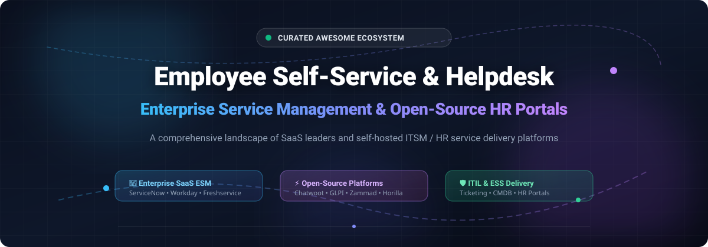

# 🏢 Awesome Employee Self-Service &amp; Internal Helpdesk 🎧

**Curated list of awesome SaaS platforms, open-source projects, and self-hosted employee portals for HR service delivery, internal helpdesk, and IT Service Management (ITSM).**

  
  
  
  
  
  
  

---

## 🧭 Overview &amp; Ecosystem Introduction

This repository tracks top-tier **enterprise SaaS platforms** and **active open-source GitHub projects** designed for **Employee Self-Service (ESS), Internal Helpdesk, and Enterprise Service Management (ESM)**. 

Modern internal helpdesks provide employees with a unified portal to submit tickets, resolve HR inquiries, request IT hardware, access knowledge bases, and automate repetitive organizational workflows.

### 🌟 Key Highlights
- **SaaS Category Leaders**: ServiceNow Employee Center, Freshworks Freshservice, Workday ESS, Rippling, and BambooHR.
- **Data Sovereignty &amp; Privacy**: Full coverage of community-maintained, self-hosted, and open-source alternatives like Chatwoot, ERPNext HRMS, GLPI, Zammad, FreeScout, osTicket, and Horilla HR to bypass per-employee recurring subscription costs.
- **Comprehensive Metadata**: Starting tier pricing, specific free trial durations/limits, company scale/market caps, and live GitHub stargazer counts.

---

## 📑 Table of Contents
- [📊 Sector Overview &amp; Market Dynamics](#-sector-overview--market-dynamics)
- [☁️ SaaS &amp; Hosted Platforms](#️-saashosted-platforms)
- [🔓 Open-Source GitHub Projects](#-open-source-github-projects)
  - [🏆 Top Ranked Open-Source Platforms](#-top-ranked-open-source-platforms)
  - [🛠️ Additional Modular &amp; Specialized Open-Source Tools](#️-additional-modular--specialized-open-source-tools)
- [🤝 How to Contribute](#-how-to-contribute)
- [💖 Support &amp; Sponsorship](#-support--sponsorship)
- [📈 Star History](#-star-history)
- [⚖️ Disclaimer](#️-disclaimer)

---

## 📊 Sector Overview &amp; Market Dynamics

The global employee self-service (ESS) and internal helpdesk software market is estimated at approximately **$6.4B to $9.8B** (scaling upward to **$14B–$26B** when factoring in adjacent enterprise IT service desk suites), expanding at a compound annual growth rate (CAGR) of **8.5%–11%**. 

The sector is **moderately to highly fragmented** rather than winner-take-all: while enterprise titans (such as ServiceNow and Workday) capture large enterprise core deployments, organizations frequently operate multi-vendor stacks where mid-market suites, agile AI-native ticketing disrupters (like Freshworks and Rippling), and specialized self-hosted portals coexist.

---

## ☁️ SaaS/Hosted Platforms

| Product | Scale (Valuation / Revenue) | Description | Pricing (Starting Tier) | Free Tier / Trial Limits |
|---------|-----------------------------|-------------|-------------------------|--------------------------|
| **[ServiceNow Employee Center](https://www.servicenow.com/)** | **~$104B–$159B Market Cap** (~$13.3B–$15.4B TTM revenue) | Enterprise service management portal unifying IT, HR, legal, finance, and workplace services. North America held 42.31% of the employee helpdesk market in 2025; targets $30B+ subscription revenue by 2030 with AI exceeding 30% of ACV. | From **$70/fulfiller/month** (Foundation tier; ~$10k–$20k/yr min contract) | No free tier; demo &amp; guided test drives via sales only (no self-serve free trial) |
| **[Workday Employee Self Service](https://www.workday.com/)** | **~$46B–$51B Market Cap** (~$10.15B TTM revenue) | Enterprise HCM with comprehensive ESS for pay, benefits, time, and personal data. FSE-based pricing model weights worker types—count overages of 8–18% above clean census are common. | From **$35–$100/employee/year** (~$3–$8.33/emp/mo; typical $100k/yr min contract) | No free tier; interactive online video tours &amp; custom demo via sales only (no self-serve free trial) |
| **[UKG Pro](https://www.ukg.com/)** | **~$22B Valuation** (~$4.5B–$4.7B annual revenue) | Enterprise HCM with ESS, payroll, and workforce management. Positioned for mid-market and enterprise organizations. | From **$26/employee/month** (core UKG Pro tier; PEPM model) | No free tier; interactive test environments &amp; guided sales demo only (no self-serve free trial) |
| **[Rippling](https://www.rippling.com/)** | **~$16.8B Valuation** (~$1.0B ARR) | Unified HR, payroll, benefits, devices, and apps. Modular pricing means you pay for what you enable. | From **$8/user/month** (base platform fee plus selected app add-ons) | No free tier; customized sales demo required (occasional 14-day trials limited to select IT/device modules) |
| **[Paylocity](https://www.paylocity.com/)** | **~$9.3B–$10.0B Market Cap** (~$1.77B annual revenue) | Mid-market HCM with ESS, payroll, and time tracking. Typical comprehensive mid-market implementations average $22–$32 PEPM. | From **$2–$5/employee/month** (base core setup; typical bundles start ~$200/mo base) | No free tier; interactive self-paced web tours &amp; guided sales demo only (no self-serve free trial) |
| **[Personio](https://www.personio.com/)** | **~$8.5B Valuation** (~$350M–$435M annual revenue) | European HRIS with ESS for SMBs. Core tier several dollars PEPM; 15–30% discounts achievable for 100–200 employees with multi-year terms. | From **€7.60 (~$8.00)/employee/month** (Core plan, 12-month annual commitment) | **14-day free trial** with sample data and demo employees (caps: max 3 e-signatures, 50 survey participants, outbound emails disabled; no credit card required) |
| **[Freshworks Employee Center (Freshservice)](https://www.freshworks.com/)** | **~$3.15B–$3.5B Market Cap** (~$904M TTM revenue) | AI-first service delivery with employee portal, knowledge base, and ticketing. Freshworks expanded AI-first HR service delivery in 2026 for faster, lower-complexity adoption. | From **$19/agent/month** (Starter tier, billed annually) | **14-day free trial** (full unrestricted access to features, no credit card required; no permanent free tier) |
| **[BambooHR](https://www.bamboohr.com/)** | **Est. ~$274M–$358M Annual Revenue** (PE-backed private) | SMB-focused HRIS with self-service, time-off tracking, and document storage. Month-to-month available with automatic volume discounts. | From **$10/employee/month** (Core package; Pro: $17, Elite: $25) | **7-day free trial** (full platform access with sample employee data, no credit card required; no permanent free tier) |

---

## 🔓 Open-Source GitHub Projects

Open-source and self-hosted tools provide data sovereignty, customization flexibility, and complete independence from compounding per-seat SaaS costs. Below are top active repositories, sorted in descending order by GitHub stargazer count.

### 🏆 Top Ranked Open-Source Platforms

| Project | Star Badge | Description | Primary Technology |
|---------|------------|-------------|-------------------|
| **[Chatwoot](https://github.com/chatwoot/chatwoot)** |  | **Open-source customer and internal employee engagement suite.** Provides real-time live chat, ticketing, shared inboxes, and internal team collaboration channels with mobile support and native integrations. | Ruby on Rails, Vue.js |
| **[ERPNext HRMS](https://github.com/frappe/hrms)** |  | **Comprehensive open-source HRMS and employee self-service portal.** Offers dedicated modules for employee onboarding, leave management, payroll, expense claims, attendance tracking, and employee helpdesk tickets. | Python, Frappe Framework, JS |
| **[GLPI](https://github.com/glpi-project/glpi)** |  | **Industry-standard open-source ITSM and service desk platform with employee self-service.** Features an intuitive user portal, ITIL service desk workflows, asset management/CMDB, license tracking, and SLA escalation. | PHP, MySQL, Web |
| **[Zammad](https://github.com/zammad/zammad)** |  | **Web-based open-source user support and internal helpdesk system.** Features multi-channel support (email, chat, telephone), automated assignment rules, SLA management, and an accessible self-service employee ticket view. | Ruby on Rails, PostgreSQL |
| **[FreeScout](https://github.com/freescout-help-desk/freescout)** |  | **Lightweight self-hosted helpdesk &amp; shared inbox alternative.** Super-clean UI tailored for fast employee ticketing, internal conversations, collision detection, and custom modules without bloated overhead. | PHP, Laravel, MySQL |
| **[osTicket](https://github.com/osTicket/osTicket)** |  | **Widely-used open-source support ticket system.** Features a straightforward self-service web portal for employees, custom fields, ticket filters, auto-responders, and role-based permissions. | PHP, MySQL |
| **[Frappe Helpdesk](https://github.com/frappe/helpdesk)** |  | **Modern, lightning-fast open-source service desk built on Frappe.** Provides an employee portal, SLA tracking, knowledge base articles, automated ticket routing, and deep integration with Frappe HRMS. | Python, Vue.js, Frappe |
| **[Horilla HR](https://github.com/horilla/horilla-hr)** |  | **Modern open-source HRMS with built-in employee helpdesk module.** Complete ESS covers profile, leave, attendance, payslips, document requests, and centralized HR support ticketing with Docker deployment. | Python, Django, PostgreSQL |
| **[Trudesk](https://github.com/polonel/trudesk)** |  | **Open-source real-time helpdesk ticketing system.** Built with Node.js and MongoDB, featuring a clean UI, dynamic ticket queues, internal notes, notifications, and employee self-service knowledge base. | Node.js, MongoDB, React |
| **[iTop](https://github.com/Combodo/iTop)** |  | **Open-source ITIL-aligned ITSM and CMDB platform with employee portal.** Web-based service management providing incident, service request, change, and problem management with an employee-facing catalog. | PHP, MySQL, Apache |
| **[Znuny](https://github.com/znuny/Znuny)** |  | **Open-source ticket management system (OTRS Community Edition successor).** Designed for enterprise IT teams needing audit-proof ticket trails, self-service portals, and SAML/LDAP authentication. | Perl, JavaScript, MariaDB |
| **[FreeITSM](https://github.com/edmozley/freeitsm)** |  | **Modern open-source ITSM tool with self-service portal and asset tracking.** Features Kanban/timeline views, QR-code asset register, knowledge base with AI chat, and 138+ workflow triggers. | TypeScript, React, Python |
| **[Microsoft ESS Agent Dev Kit](https://github.com/microsoft/Employee-Self-Service-Agent-Developer-Kit)** |  | **Official Microsoft developer kit for AI-powered Employee Self-Service agents.** Accelerates building internal HR and IT Copilots connected to Microsoft 365, Teams, and enterprise knowledge backends. | TypeScript, Azure AI, C# |
| **[KIX Backend](https://github.com/kix-service-software/kix-backend)** |  | **Open-source technical service management and ITSM solution.** Provides backend services for ticketing, asset management, and enterprise internal support workflows. | Perl, Docker, REST API |
| **[Digital Workplace Employee Hub](https://github.com/WRVish/digital-workplace-employee-hub)** |  | **Free open-source employee portal for Microsoft 365.** SPFx and Power Apps versions with SharePoint backend for user management, leave administration, asset custody, and internal ticketing. | React, TypeScript, SPFx |

---

### 🛠️ Additional Modular &amp; Specialized Open-Source Tools

- 💡 **Need an all-in-one HR + Helpdesk**: Choose **[ERPNext HRMS](https://github.com/frappe/hrms)** or **[Horilla HR](https://github.com/horilla/horilla-hr)** for built-in leave management, payroll, and internal support ticketing in a single system.
- 💻 **Need full ITIL Service Management &amp; CMDB**: Choose **[GLPI](https://github.com/glpi-project/glpi)** or **[iTop](https://github.com/Combodo/iTop)** for complete hardware/software lifecycle and configuration tracking.
- ⚡ **Need a modern lightweight ticket system**: Choose **[Zammad](https://github.com/zammad/zammad)**, **[FreeScout](https://github.com/freescout-help-desk/freescout)**, or **[Frappe Helpdesk](https://github.com/frappe/helpdesk)**.
- 🤖 **Need AI-First Employee Copilots**: Check out the **[Microsoft Employee Self-Service Agent Developer Kit](https://github.com/microsoft/Employee-Self-Service-Agent-Developer-Kit)**.
- 🏢 **For Microsoft 365 / SharePoint Shops**: Deploy **[Digital Workplace Employee Hub](https://github.com/WRVish/digital-workplace-employee-hub)** for zero external infrastructure footprint.

---

## 🤝 How to Contribute

Contributions are warmly welcome! If you know of an awesome SaaS platform or open-source tool for employee self-service or internal ticketing:

1. 🍴 Fork this repository.
2. 🌿 Create a descriptive feature branch (`git checkout -b feature/add-new-tool`).
3. 📝 Add your entry into `README.md` maintaining table formats, valid star badges, and factual descriptions.
4. 🚀 Push your branch and open a Pull Request.

---

## 💖 Support &amp; Sponsorship

If this curated repository helped you design your internal helpdesk architecture or evaluate employee self-service solutions, please consider supporting the project:

- ⭐ **Star this repository** to help others discover it on GitHub!
- 🍴 **Fork and share** it with your fellow engineering, HR, and IT operations teams.
- ☕ **Buy me a coffee**: Support ongoing curation and maintenance via the [GitHub Sponsors Dashboard](https://github.com/sponsors/ishandutta2007).

Thank you for being part of the open source community! 🙌

---

##  Star History

---

## ⚖️ Disclaimer

- This is a **community-curated directory** — not an endorsement of any vendor or software package.
- Employee self-service and helpdesk software handle sensitive employee PII, support communications, and organizational credentials. Ensure proper data protection, encryption at rest/transit, and role-based access control (RBAC).
- Pricing, terms, and GitHub repository metrics are subject to change. Always verify requirements against your organization's compliance standards.

---

  <b>Made with ❤️ for HR service delivery teams, IT administrators, and DevOps engineers.</b>

